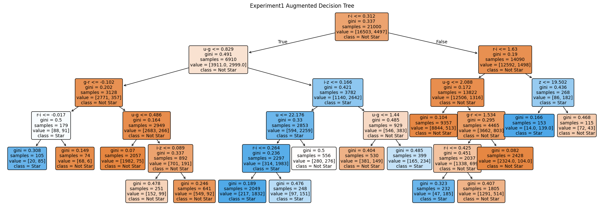
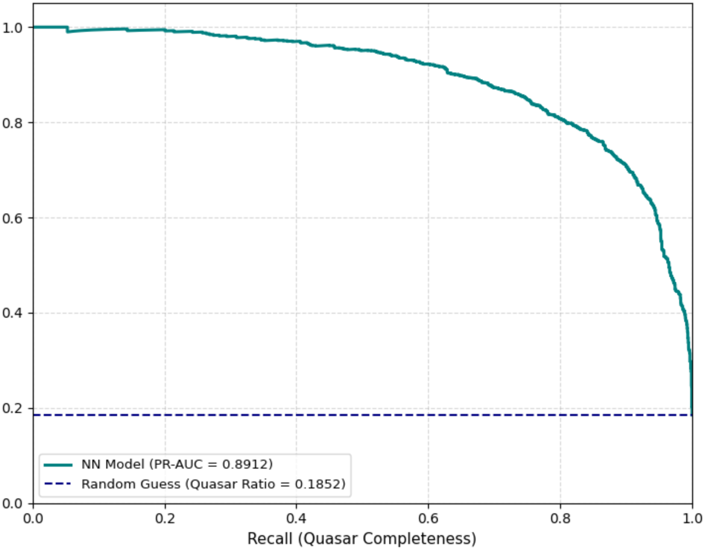
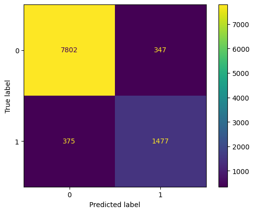
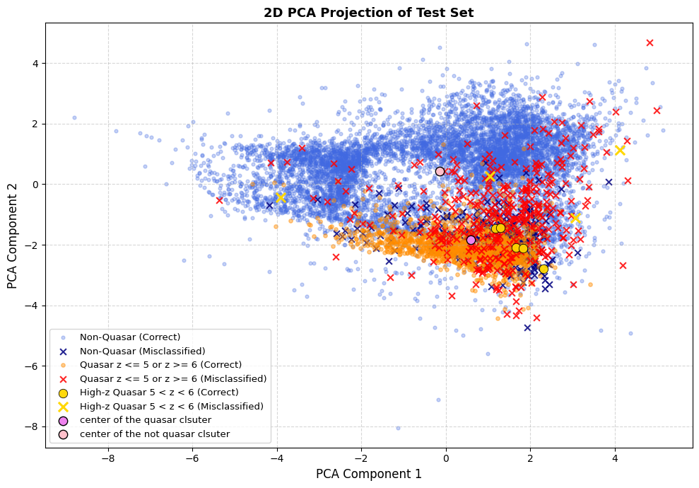

# Photometric Classification of Celestial Objects & High-Redshift Quasars (SDSS17)

## Overview

In modern observational astronomy, imaging photometry across broadband filters (`u, g, r, i, z`) is relatively inexpensive to collect across wide sky surveys, whereas measuring **spectroscopic redshift** requires resource-intensive fiber-optic follow-up. 

This project investigates the intrinsic structure, dimensionality, and predictive boundaries of Sloan Digital Sky Survey (**SDSS17**) five-band optical photometry (`UGRIZ`) through three hypothesis-driven experiments—evaluating **distance-invariant color engineering**, **PCA manifold structure**, and **non-linear quasar classification without redshift**, including a targeted error analysis on rare high-redshift quasars (\(5 < z < 6\)).

---

## Key Highlights & Results

1. **Astrophysics-Informed Feature Engineering (Experiment 1):**  
   Engineering adjacent filter differences (`u-g, g-r, r-i, i-z`) mitigates distance-induced flux attenuation. In a constrained Decision Tree classifier (`max_depth=5`, `max_leaf_nodes=16`), **13 out of 15 internal splits** selected color-difference features over raw magnitudes, substantially improving Precision, Recall, and MSE.
2. **Low-Rank Photometric Manifold (Experiment 2):**  
   Principal Component Analysis (PCA) reveals that raw `UGRIZ` magnitudes span an approximately **2D subspace (>95% explained variance)** governed by overall apparent brightness (`PC1`) and spectral color slope (`PC2`), while class boundaries between stars, galaxies, and quasars remain strongly non-linear.
3. **Quasar Identification Without Redshift (Experiment 3):**  
   A PyTorch Multi-Layer Perceptron (`MLP` with `SiLU` activations, `BatchNorm1d`, and `AdamW`) trained on standardized `UGRIZ` + color-difference features (without `redshift`) achieves:
   * **ROC-AUC:** `0.9672`
   * **PR-AUC:** `0.8912` (**4.8×** over the `0.1852` random-selection baseline)
   * **Precision / Recall:** `80.98%` / `79.75%` (`TP=1,477, TN=7,802, FP=347, FN=375`)
4. **High-Redshift (\(5 < z < 6\)) Slice & Interpretability Analysis:**  
   On the rare \(5 < z < 6\) quasar subset ("redshift gap"), the MLP recovers **5 / 9 (55.56%)** candidates compared to **6 / 9 (66.67%)** by Nearest-Centroid (K-Means style) clustering. Standardized 9D Euclidean distance and 2D PCA projections show that misclassified high-\(z\) quasars drift far from the main quasar core (`mean d = 4.51`) into the cool galactic M-dwarf locus (`mean d = 4.28`), quantitatively confirming the **optical color degeneracy** bottleneck documented in astrophysics literature.

---

## Visual Summary


| Experiment 1: Decision Tree Splits | Experiment 3: ROC & PR Curves |
| :---: | :---: |
|  |  |
| *13/15 splits utilize adjacent color differences* | *ROC-AUC = 0.9672, PR-AUC = 0.8912* |

| Experiment 3: Confusion Matrix | Experiment 3: High-\(z\) (\(5 < z < 6\)) PCA Error Analysis |
| :---: | :---: |
|  |  |
| *Test set (\(N = 10,001\)) classification breakdown* | *Yellow markers highlight \(5 < z < 6\) quasars relative to cluster centers* |

---

## Repository Structure

```text
├── sdss_photometric_classification.ipynb   # Full Jupyter Notebook with code, plots, and analysis
├── sdss_quasar_mlp_best.pth                # Saved best PyTorch model weights & StandardScaler stats
├── requirements.txt                        # Python dependencies
├── assets/                                 # Exported figures for README
└── README.md
```

---

## Quickstart

### 1. Installation
```bash
git clone https://github.com<your-username>/sdss-quasar-classification.git
cd sdss-quasar-classification
pip install -r requirements.txt
```

### 2. Run the Notebook
Open `sdss_photometric_classification.ipynb` in Jupyter Lab / VS Code / Google Colab and run all cells. The dataset (`fedesoriano/stellar-classification-dataset-sdss17`) is automatically downloaded via `kagglehub` (with invalid `-9999` sensor readings filtered out during preprocessing).

### 3. Load Pretrained Model Weights for Inference
```python
import torch
import torch.nn as nn
import sklearn.preprocessing

device = "cuda" if torch.cuda.is_available() else "cpu"

model = nn.Sequential(
    nn.Linear(9, 32),
    nn.SiLU(),
    nn.Linear(32, 64),
    nn.SiLU(),
    nn.Linear(64, 128),
    nn.SiLU(),
    nn.BatchNorm1d(128),
    nn.SiLU(),
    nn.Linear(128, 1)
).to(device)

checkpoint = torch.load("sdss_quasar_mlp_best.pth", map_location=device, weights_only=False)
model.load_state_dict(checkpoint["model_state_dict"])
model.eval()

scaler = sklearn.preprocessing.StandardScaler()
scaler.mean_ = checkpoint["scaler_mean"]
scaler.scale_ = checkpoint["scaler_scale"]
```

---

References Fukugita, M., Ichikawa, T., Gunn, J. E., Doi, M., Shimasaku, K., & Schneider, D. P. 1996, AJ, 111, 1748   Lenz, D. D., Newberg, H. J., Rosner, R., Richards, G. T., & Stoughton, C. 1998, ApJS, 119, 121   Richards, G. T., Fan, X., Newberg, H. J., et al. 2002, AJ, 123, 2945   Yang, J., Fan, X., Wu, X.-B., et al. 2017, AJ, 153, 184  
